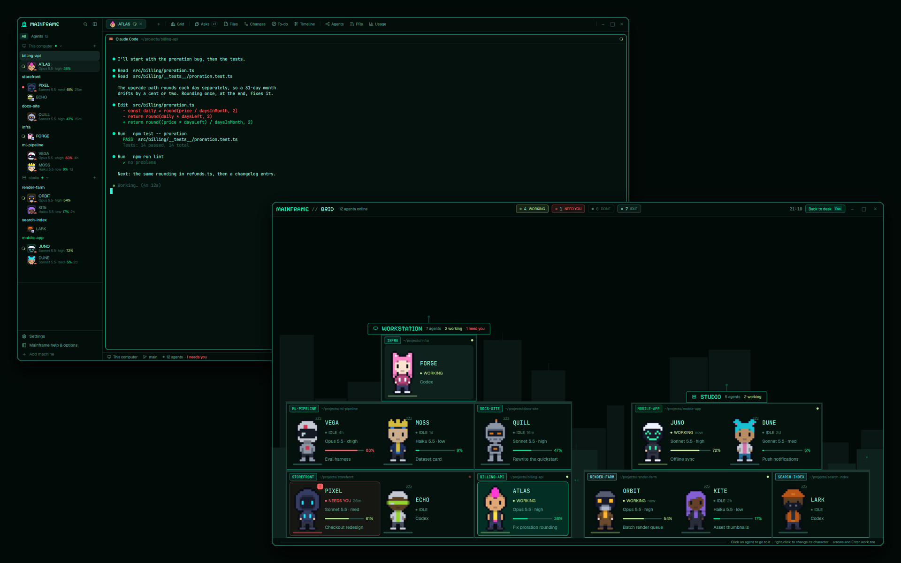
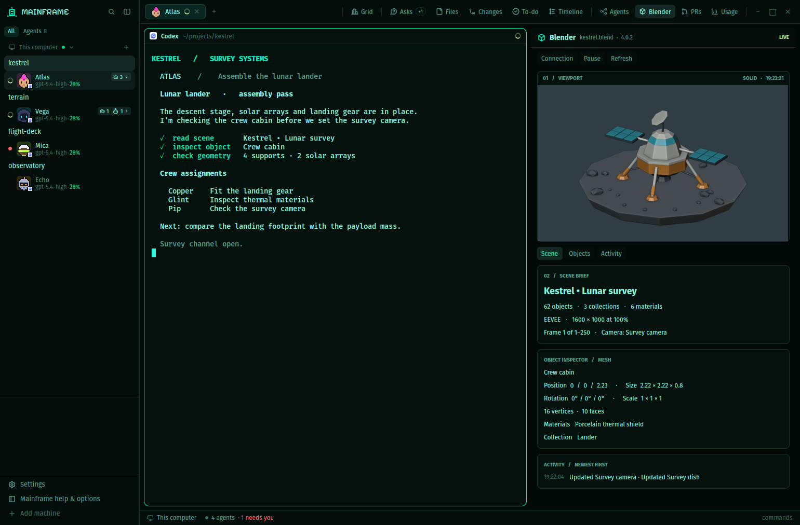
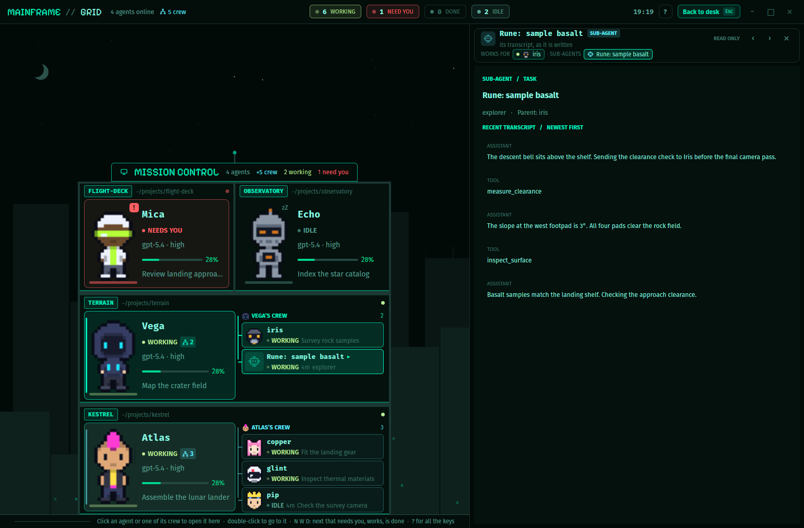

# Mainframe

A [Herdr](https://herdr.dev) layout for running many coding agents on several computers: a desk with every agent in the sidebar, and the Grid, where each agent stands in its room with what it is doing. Both screens follow your theme. It comes with Cyan Matrix.

## What's in it

- **The Grid** (`Ctrl+Shift+Y`): one tower per computer, one room per space, one pixel character per agent, with status, model, context used and task. A screen to stay on: click an agent and its session opens beside the towers as a live terminal you type in; double-click to go to it at the desk.
- **Families:** agents that started other agents, on this computer or another, share a colour, say who started them, and light up together. Open one and the dock's header lists the rest; click one to open it there.
- **44 characters.** Each agent gets one and keeps it, on its sidebar row, its tab and in the Grid.
- **One bar for everything:** Asks, Files, Changes, To-do, Timeline, an agents graph, PR review and usage, in groups at the right end that shrink to icons when the tabs need room.
- **A sidebar that reads cleanly:** Over9k's, with rows that show what fits whole.
- **Help & options** in the sidebar's footer: a guide, your keys, and four options.

| The desk | The Grid |
|---|---|
|  |  |

The agents and projects in these pictures are made up.

## Install

Ask an agent in Herdr: "add the layout at herdr.dev/layouts/LexingtonStanley/herdr-mainframe". It reads `RECIPE.md`, copies `layouts/`, `themes/` and each folder in `mods/` into `~/.config/herdr-app`, merges `keys.json`, and switches to it.

By hand: copy the same things (move each mod folder in whole), then press `Ctrl+Shift+L` until Mainframe shows.

It runs `git`, `python3` and shell scripts, and `gh` or `glab` if you have them. Linux and macOS; on Windows the sidebar does less.

## Add-ons

Two buttons appear only when their mods are installed, because each has an installer of its own:

- **Chat**: a tab's agent as a conversation. Needs [Flockbook](https://github.com/minchenlee/flockbook); then add its three views to the layout's `view` stack (the snippet is in `RECIPE.md`).
- **Nvim**: Neovim beside the tab with a file tree. Needs [herdr-nvim](https://github.com/ChmaraX/herdr-nvim); its installer adds itself to the layout.

## Credits

Mainframe is built on other people's work, all MIT licensed:

- [Over9k](https://github.com/herunan/herdr-over9k): the sidebar, usage rows, To-do, Timeline, menus and dialogs.
- [herdr-agent-ask](https://github.com/sachin-philip/herdr-agent-ask): the Asks panel and its engine.
- [Emergence](https://github.com/shoaibkhanz/emergence): the agents graph, PR review and usage panels.
- [Flockbook](https://github.com/minchenlee/flockbook) and [herdr-nvim](https://github.com/ChmaraX/herdr-nvim): the add-ons.

The Grid, the characters, the bar's grouping, the chrome, the options and the Cyan Matrix theme are new here. Licences: `LICENSE` for what is new, `LICENSES.md` for the rest.
