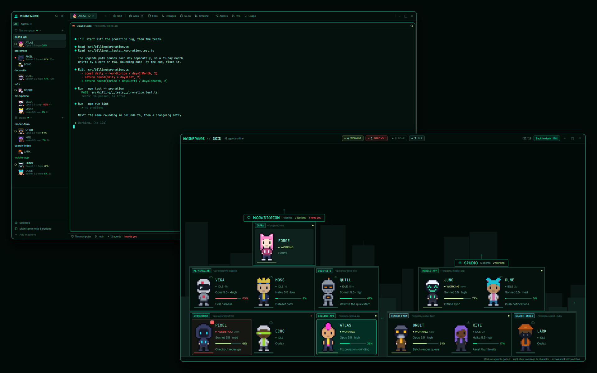

# Mainframe

A Herdr layout for running many coding agents on several computers. One screen is a desk: every space and agent in a sidebar, each agent with a pixel character of its own, tabs and terminal panes in the middle, and one side panel that turns into Asks, Files, Changes, To-do, Timeline, an agents graph, PR review or usage. The other screen is the Grid: every agent standing in a room of a tower, one tower per computer, with its status, model, context used and task, the agents it started linked to it by colour, and a dock beside the towers where a clicked agent's session opens as a live terminal. Both screens take every colour from the theme, and the layout comes with Cyan Matrix, a theme whose panels match its terminals.

## What you see

**The desk**, left to right:

- **Sidebar**, 268px (drag 44 to 480), colour `chrome`.
  - Brand row, 46px, drags the window: an 18px pixel mark in `accent`, `MAINFRAME` in Pixelify Sans 17px weight 600, then two 26px buttons (find a space, fold the sidebar).
  - The list (Over9k's sidebar): spaces grouped by computer, or agents grouped by status (Needs you, Done, Working, Idle). An agent row is 36px: a 28px tile with its character's face, its name at 12.5px, and under it one 11px line of what fits whole: folder, computer, model, effort, context used, time since its last reply, `exp.` when its prompt cache has expired.
  - Usage rows, 150px: plan limits per service (Over9k's `over9k-usage`).
  - Footer, 97px: Settings, Mainframe help & options, Add machine, each a 28px row.
- **Work area.**
  - Tab bar, 46px, drags the window: the space's tabs as 29px pills (a one-agent tab shows that agent's face, 21px) with `+` after the last, in all the width the buttons leave; at the right end three groups of 26px buttons with a 1px × 16px `border` rule between them: Grid; Asks, Files, Changes, To-do, Timeline; Agents, PRs, Usage. Window buttons at the end where the system draws none.
  - Panes: 8px padding and gap, each pane a card with radius 10, a 1px `border` (1px `accent` while focused) and a 30px header (Herdr's `pane`).
  - Side panel, hidden until a button opens it: 368px for Asks, Files, Changes, To-do and Timeline; 620px Agents, 860px PRs, 760px Usage. Each remembers the width it was dragged to.
  - Status bar, 28px (Herdr's `workspace-status`).

**The Grid** fills the window:

- A 46px bar: `MAINFRAME // GRID` in Pixelify Sans 19px (`accent`, `dim`, `foreground`), how many agents are online, four counts (Working, Need you, Done, Idle) as 26px chips, the clock, a Back to desk button showing `Esc`.
- The scene, colour `canvas`: a quiet skyline drawn from the theme (two rows of blocks at 5% and 9.5% of `foreground` over `canvas`, a few 4×5px windows in `accent` at 40%), a 26px street at the bottom, and the towers standing on it.
- A tower is a computer: a 36px sign with its name in Pixelify Sans 20px `accent` and its counts, a mast with a pulsing light, then floors of rooms with 4px walls and 8px slabs (17% of `foreground` over `background`).
- A room is a space: its name in a 1px-bordered tag in the space's colour, its folder at 11px `dim`, and its agents side by side.
- A station is an agent: its whole character (14 × 24 cells at 4, 5 or 6px a cell, the biggest that fits every tower in the window), its name in the terminal font, bold, 15px at the smallest size and 18px at the largest, a status word in the status colour, `+N` for its own running sub-agents, model and effort, a 4px context bar (the theme's green under 50%, yellow under 80%, red above), its task. An agent in a family (below) has instead of its task a line in the family's colour: `◂ NAME` (with that agent's face) for who started it, and a family icon, how many it started and a dot in each one's status colour; and a 3px bar in that colour down its left edge. The station open in the dock has an `accent` outline and an `OPEN ▸` tag at its top right.
- The dock, on the right when an agent is open (640px, drag 360 to 1400): a 66px header and under it the agent's terminal, a card like the desk's panes with an `accent` border while it has the keyboard. The header: the agent's face (no pane, no character: its program's icon), name, status, model, context and computer; `TYPING HERE` or `CLICK TO TYPE`; Open at desk (Peek at desk for one with no pane) and close. Its second line is the family as chips: Started by, With (the others the same agent started), Started, and `+N sub-agents` (hover for what each was given); a chip has a status dot, a face or icon, the name and, on another computer, that computer's name.

**Colours.** Nothing is hard-coded except the characters. Cyan Matrix: `background` `#04110d`, `foreground` `#8af7e4`, `accent` `#00f0c0`, `muted` `#57a092`, `dim` `#3b7166`, `canvas` `#020a08`, `chrome` `#030d0a`, `border` `#8af7e424`, working `#b8e994`, blocked `#ff5d62`.

## How it behaves

- **Status.** Working: a spinner on the sidebar row and the tab; in the Grid the character bobs 3px every 640ms and the pad under its feet pulses. Blocked: a red dot in the sidebar; in the Grid a red `!` badge bounces, the station gets a red outline and its room a red dot. Done: a dot in the theme's `done` colour on the tab, a `✓` badge in the Grid. Idle: dimmed, `zZz` over the character.
- **Characters.** 44 of them. A new agent takes the next one nobody has and keeps it. An agent alone in a tab somebody named is remembered by that name, so it has the same character after a restart. Right-click a station (or press C on it) for a picker of all 44; a dot marks the ones in use.
- **The Grid.** The Grid button or `ctrl-shift-y` opens it; the same key, Back to desk, or `Esc` with the dock closed returns, and the keyboard goes back to the terminal it was in. It is a screen to stay on: click a station and that agent's session opens in the dock, with the keyboard, to type in as at the desk; click another and the dock turns to it; the towers re-plan to the width the dock leaves. Double-click a station (or Open at desk) to go to the agent at the desk. Arrows move a pick (left and right by agent, up and down by room), Enter opens it in the dock, Space opens it and keeps the keyboard on the towers, Shift+Enter goes to it at the desk, `Esc` closes the dock, Shift+Tab goes back. A press on the towers takes the keyboard back from the dock. The desk behind stays where you left it. In a window too narrow for the towers side by side they stack, and the pick's floor scrolls into view.
- **Families.** An agent that started agents (Herdr's core records each terminal's parent: `hc run` from an agent, on this computer or another) is a family with them, in a colour of its own from the theme (`ansi5`, `ansi6`, `ansi3`, `ansi4`, `ansi2`, `ansi13`, `ansi14`, `ansi11`, by the family's first agent). Hovering, picking or opening one lights up every station in its family with an outline in that colour. Agents started without a pane of their own have no station: they are their starter's dots and chips, and open in the dock from there.
- **The bar.** A button's tooltip says what it does and its key. When the tabs need the room (about 130px a tab, up to 60% of the bar) the groups go down to icons from the right. More tabs than fit scroll sideways in their own width (never less than 150px); the buttons stay at the right. The Asks button counts questions waiting in this space on a `blocked` pill, and those in other spaces as `+N`.
- **Sidebar rows.** When a row's line is too long for the sidebar, effort goes first, then model, then the time, then the folder is cut from the front (`…/name`). No word is cut off at the edge.
- **Space colours.** A space's colour is the theme's ansi colour (the theme's bright magenta stands in for red, which means "needs you"). Options › Space colours › Vivid gives Over9k's six fixed colours.
- **Options.** Mainframe help & options has a Guide, the layout's Keys as keys.json has them now, and four options saved in shared `mainframe.options`: `toolbar` (`auto`, `labels`, `icons`), `spaceColors` (`theme`, `vivid`), `tabFaces`, `backdrop`. A button there opens Over9k's own options, which decide what the sidebar's rows show.
- **Keys** (`keys.json`, section `layout:mainframe`): `ctrl-shift-y` Grid, `ctrl-shift-a` Asks, `ctrl-shift-d` Agents, `ctrl-shift-r` PRs, `ctrl-shift-u` Usage, `ctrl-tab` Over9k's switcher, `ctrl-shift-w` and `ctrl-shift-x` close a tab or pane after asking, `ctrl-shift-g` Chat and `ctrl-shift-i` Nvim once those are added (below).

## Built from

**Layout** (`layouts/mainframe.json`): root `column`, `titlebar: "none"`, `theme: "cyan-matrix"`, `terminal_padding: [14, 12]`, `terminal_menu: "over9k-menu"`. Its children:

- `deck`, a `stack`: `desktop` (a `row`: `sidebar` column and `work` column) and `grid` (a `column`: `grid-bar` 46px and `grid-body`, a `row` of `grid-scene` and `grid-dock`). `grid-dock` is a column, hidden until an agent is opened: `grid-dock-head` (66px, the Grid with `view: "dock"`) and `grid-term`, the terminal block the Grid writes the open agent into (`{ "terminal": "t7" }`; shipped as `{ "agent": "focused" }`).
- `grid-keys`, a 0px block that is always shown: the Grid mod with `view: "keys"`, so its key works on both screens (a mod only hears its commands while shown).
- `screen`, a 0px `stack` of four blank blocks, and inside `work` the stack `view` with one child, `view-tab` (`{ "tab": "active" }`). Both are there for the Chat add-on.
- `panel` (hidden) holds the stack `panel-body`: `files-browser` and `files` (both Herdr's `files`), `changes`, `todos`, `prompts`, `asks`, `graph`, `prs`, `usage-panel`.

**Mods of its own:**

- `mainframe-tabs`: the tab bar. Commands `toggle` and `open` (Asks), `chat`, `nvim`, `graph`, `prs`, `usage-panel`, `recheck`, `back`, `rail`. Carries the Asks engine (`engine.js`, `parse.js`, `state.js`) so questions are found while the panel is closed.
- `mainframe-side`: Over9k's sidebar with the characters, the fitted info line and theme space colours. Shares `mainframe.info` (per agent: model, effort, context, last reply, how many it started, and `inner`, its own running sub-agents) and `mainframe.homes` (each computer's home folder) for the Grid.
- `mainframe-grid`: the Grid, by `props.view`: `bar`, `scene`, `dock`, `keys`, `picker`, `blank`. Commands `toggle`, `open`, `close`, `focus`, `pick`. The agent open in the dock is shared as `mainframe.dock`. Holds the cast: `build.py` draws `chars/<id>.svg` and `chars/<id>-face.svg` from letter grids and writes `roster.js`; `cast.js` hands characters out and saves who plays whom in shared `mainframe.cast`. `cast.js`, `roster.js` and `agent-name.js` are copied into the tab bar and the sidebar, since mods can't import from each other.
- `mainframe-agents`, `mainframe-prs`, `mainframe-usage`: Emergence's agents graph, PR review and usage panels, with `props: { panel: true }`.
- `mainframe-chrome`: the brand row, and with `props: { footer: true }` the footer.
- `mainframe-options`: the help & options dialog.

**Other people's mods it uses**, in this folder: Over9k's `over9k`, `over9k-usage`, `over9k-menu`, `over9k-todos`, `over9k-prompts`, `over9k-close`, `over9k-rename`, `over9k-switcher`, `over9k-server-stop`, `over9k-options`, `over9k-new-menu`, `over9k-panel`, `over9k-handoff`; and `asks` from herdr-agent-ask. Herdr's own: `files`, `changes`, `pane`, `workspace-status`, `workspace-chrome` (icons), `new-menu`, `picker`, `machine-add`, `worktree`.

**Herdr functions:** `agents`, `spaces`, `machines`, `panes`, `terminals`, `layout`, `theme`, `keys`, `shared`/`setShared`, `openOverlay`/`closeOverlay`, `nextCommand`, `exec`, `hc`, `readTextFile`, `fonts`, `window`. **Commands:** `layout.select`, `layout.show`, `layout.hide`, `layout.resize`, `space.select`, `tab.select`, `tab.move`, `pane.focus`, `mod.open`, the window commands.

**Programs it runs:** `sh`, `git`, `python3`; `gh` and `glab` when installed (repo badges, PRs); `claude` or `codex` for the Asks classifier; `hostname` for this computer's tower. **Files it writes:** besides its mods' own data, the Grid writes the opened agent's terminal into `grid-term` in `layouts/mainframe.json` (nothing else in it changes). **Art:** the 44 characters are original, drawn by `build.py`. The font is Pixelify Sans (OFL 1.1, `mods/mainframe-grid/fonts/`).

**Add-ons**, each with an installer of its own, so they are not in the layout file (Herdr won't show a layout that names a mod it can't find):

- **Chat** needs [Flockbook](https://github.com/minchenlee/flockbook). Once its `flockbook` mod is installed, add three children to the stack `view`: `{ "id": "view-chat", "type": "block", "content": { "mod": "flockbook", "props": { "view": "chat" } } }` and the same with `needs` and `overview`. The Chat button appears.
- **Nvim** needs [herdr-nvim](https://github.com/ChmaraX/herdr-nvim). Run its installer for the app while Mainframe shows: it turns the panel child `files` into its file tree and adds its pane header and controller. The Nvim button appears, and `files-browser` stays Herdr's Files.

## Watch out

- Create a mod's folder somewhere else and move it in whole. Herdr docks a folder it sees without a `mod.json` saying `"place": "none"` into the shown layout, and rewrites the layout file.
- A theme colour may carry alpha (`border` is `#8af7e424`): never append two hex digits to one. The Grid's `fade(colour, alpha)` and `mix(a, b, k)` replace that.
- `scroll_to_item` only moves a scroll area that gets its size from flex (`flex_1().min_h(0)` in a column). On one placed with `absolute().inset_0()` it does nothing, so the Grid's scroll area sits in a column of its own.
- Flockbook re-selects a stack named `screen` on every tab switch once its chat has been shown. Here `screen` is a zero-size stand-in that takes those selects; the tab bar copies its choice to `view` only in chat mode.
- herdr-nvim leaves Neovim open when the side panel turns to another one. The Nvim button therefore goes by Neovim itself: open, one press closes it (`herdr-nvim.files`), whatever the panel shows.
- A fresh install opens Over9k's "Set up Over9k" dialog once: the sidebar is Over9k's, and that is where its folders are chosen.
- The sidebar's helper scripts are POSIX shell and Python: Linux and macOS. On Windows the sidebar's project scan, sub-agent rows and to-dos do less.
- The keyboard's pick is scrolled into view by floor, and only when the towers are stacked. Side by side, a tower taller than the window scrolls by wheel only; stacked, a room with more rows of agents than fit shows its first rows.
- More than 44 agents: characters repeat.
- A scroll area (`overflow_x_scrollbar()`) takes all the width its parent gives it, whatever its flex says. The tab bar's tabs and the dock header's chips each sit in a box sized by flex; a bare one took the whole bar and left the tabs 150px.
- Which terminal a block shows is in the layout, and `layout.set` refuses this layout ("a host argument may not nest more than 16 levels deep"). So the Grid writes `grid-term` into the layout's file; Herdr reloads it in place and keeps every click (sizes, shown and hidden). Of the two blocks that can show a chosen terminal, only a terminal block in the file takes the keyboard from `pane.focus {terminal}`; an agent block (`agent.focus`) doesn't, and `pane.focus` then focuses the desk's pane behind the Grid, where typing can't be seen. The Grid asks only once the dock shows the terminal.

## Done when

- `herdr-app check` passes for all 22 mod folders, and `layout.switch {name: "mainframe"}` shows the layout with no "needs mods that aren't here" toast and no errors in `herdr-app status`.
- Starting an agent adds a row with a character; the same character is on its tab and in its room in the Grid.
- `ctrl-shift-y` opens the Grid from the desk and returns from it; clicking a station opens its session in the dock with `TYPING HERE` in the header, the desk behind unchanged; double-clicking lands on that agent's pane.
- An agent started with `hc run` by another (here or on another computer) shows as a dot on its starter's station and a chip in the dock's header, and opens in the dock from there.
- In a 1920px window, a space with five tabs shows them all with `+` after the last and the buttons at the right end; with the toolbar set to icons, the same. Twenty tabs scroll inside the tabs' width and the buttons stay put.
- In a 268px sidebar no agent row's second line ends in a cut-off word.
- Switching the theme to a light one (appearance light, theme `paper`) leaves both screens readable: no navy, no white-on-white.
